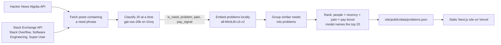

# Unmet

What are people asking someone to build? A site that ranks the problems people publicly say they want solved, read from Hacker News and Stack Exchange.

**Live:** https://unmet-tau.vercel.app

## How it works



1. **Fetch** ([unmet/fetch.py](unmet/fetch.py)): posts from the chosen window that contain one of the need phrases in [docs/PRD.md](docs/PRD.md) ("I wish there was", "would pay for", ...). Every API response is cached on disk.
2. **Classify** ([unmet/classify.py](unmet/classify.py)): the model reads 20 posts per call and returns `is_need`, a one-line `problem`, `pain` 1-3 and `pay_signal`. Replies are validated; a bad reply is retried up to 2 times with the error. At the daily quota the run stops cleanly and the next run resumes from `data/classified.json`.
3. **Cluster** ([unmet/cluster.py](unmet/cluster.py)): problem lines are embedded locally with fastembed; each need joins the closest group at cosine ≥ 0.6, else starts a new one.
4. **Rank** ([unmet/rank.py](unmet/rank.py)): score = distinct people × recency (halves every 14 days) × average pain, × 1.5 if anyone says they would pay. The model names the top 20.
5. **Publish**: `site/public/data/problems.json` holds short quotes with links and author credit. The site only reads that file and never calls a model.

Every model call goes through [unmet/llm.py](unmet/llm.py), which caches it on disk by a hash of its input.

## First run (25 Oct 2026, last 30 days)

Numbers from `site/public/data/problems.json`:

| | |
|---|---|
| Posts fetched and classified | 101 |
| Judged to be needs | 50 |
| Problems after grouping | 48 |
| Shown on the site | top 20 |

## Run it

```bash
python -m venv .venv && .venv/Scripts/pip install -e ".[dev]"
echo GROQ_API_KEY=... > .env           # free key from console.groq.com; STACKEXCHANGE_KEY is optional
python -m unmet --days 30              # backfill; rerun to resume after a quota stop
python -m pytest                       # fake model, no network
cd site && npm ci && npm run build
```

A GitHub Actions workflow runs `python -m unmet --days 1` every day and commits the new data; Vercel redeploys on the push.

## Limitations

- **Precision not measured yet.** No hand-labelled sample exists, so the site says so. Some "needs" are misreadings (a "would pay for" that is about something else).
- **Low volume.** Exact need phrases are precise but rare: 101 posts in 30 days, so nearly every problem is raised by one person and the ranking is driven mostly by recency and pain.
- **Stack Exchange adds little.** Its search does not support exact phrases, so the pipeline searches the words and keeps exact matches; only 2 of the 50 needs came from it.
- **Grouping is greedy** and depends on order; the 0.6 threshold was not tuned against labels.
- Stack Exchange content is CC BY-SA: only short quotes are kept, always with a link and the author's name. Removal requests: open an issue.
